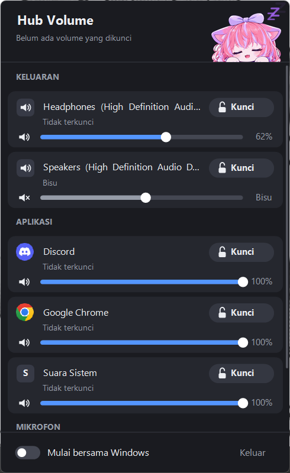

# Hub Volume

Mixer volume mini untuk Windows yang bisa **mengunci** volume perangkat keluaran, mikrofon, dan aplikasi. Kalau ada yang mengubah nilai yang terkunci — tombol media, mixer Windows, aplikasi lain, software headset — Hub Volume langsung mengembalikannya.

<p align="center">
  
</p>

Windows 10/11 · C++ native · satu executable · tanpa instalasi

## Fitur

- **Kunci per target** untuk perangkat keluaran, mikrofon, dan sesi aplikasi. Tombol kunci menyimpan level dan status bisu saat itu.
- **Berbasis event**, bukan polling. Kunci memakai callback Core Audio, jadi proses yang menganggur memakai 0% CPU.
- **Tetap berlaku saat aplikasi atau perangkat datang dan pergi.** Kunci aplikasi memakai nama exe, kunci perangkat memakai endpoint ID, sehingga otomatis aktif lagi saat Discord dibuka ulang atau headset dicolok kembali.
- **Semua perangkat aktif** ikut dipantau, bukan hanya perangkat default.
- **Berjalan di tray.** Jendela mixer hanya dibuat saat dibuka dan dihancurkan saat ditutup, termasuk sesi GDI+.
- **Autostart opsional** per pengguna, tanpa hak administrator dan tanpa scheduled task.
- **Sadar DPI**, mendukung scroll, dengan tampilan flyout gelap.
- **Satu berkas.** CRT statis, tanpa .NET, WebView2, atau Qt.

## Unduh

Ambil dari [Releases](https://github.com/thewoldaa/hub-volume/releases):

| Berkas | Keterangan |
| --- | --- |
| `HubVolume-Setup-1.0.0.exe` | Installer per pengguna, tanpa popup admin. |
| `HubVolume-1.0.0-portable.zip` | Ekstrak di mana saja, jalankan `HubVolume.exe`. |

Biner belum ditandatangani secara digital, jadi SmartScreen bisa menampilkan peringatan saat pertama dijalankan. Source tersedia di repo ini dan bisa dibangun ulang dengan langkah di bawah.

## Cara pakai

1. Jalankan `HubVolume.exe`. Ikon speaker muncul di dekat jam.
2. Klik ikon untuk membuka mixer.
3. Atur level, lalu tekan **Kunci** pada baris tersebut. Ikon kunci berubah amber dan nilainya dijaga.
4. Tekan **Terkunci** untuk melepas. **Buka kunci semua** ada di menu tray.

Bar bawah berisi **Mulai bersama Windows** dan **Keluar**. Kunci hanya bekerja selama Hub Volume berjalan; keluar saat masih ada kunci akan memunculkan konfirmasi.

Pengaturan dan daftar kunci disimpan di `%LOCALAPPDATA%\HubVolume\config.txt`.

## Build

Kebutuhan:

- Windows 10/11
- Visual Studio 2022 dengan workload Desktop C++ (atau MinGW-w64)
- CMake 3.20+
- NSIS 3.x (hanya untuk installer)

```powershell
# Exe + zip portable, sekaligus installer bila makensis tersedia
.\scripts\build.ps1

# Portable saja
.\scripts\build.ps1 -SkipInstaller
```

Hasil ada di `release/`. Build manual dengan CMake juga bisa:

```powershell
cmake -S . -B dist/build -G "Visual Studio 17 2022" -A x64
cmake --build dist/build --config Release
```

## Cara kerja

Setiap endpoint dipasangi callback `IAudioEndpointVolume`, dan setiap sesi aplikasi callback `IAudioSessionEvents`. Callback tidak pernah memanggil API audio atau menyentuh state aplikasi; ia hanya mengirim pesan berisi ID target ke jendela utama. Thread utama membaca nilai sebenarnya, membandingkannya dengan nilai kunci, lalu menulis koreksi dengan GUID privat agar perubahannya sendiri tidak memicu koreksi baru.

Koreksi untuk target yang sama dibatasi sekitar 80 kali per detik. Target yang tidak dikunci hanya dibaca saat jendela mixer terbuka. Kunci hanyalah record di `config.txt` yang ditulis secara atomik lewat berkas sementara.

## Batasan

- Bukan service: penguncian berhenti saat proses ditutup.
- Hanya per pengguna, tidak mendukung instalasi untuk semua pengguna.
- Volume dikontrol lewat WASAPI; aplikasi yang melewatinya (exclusive mode, sebagian DAW) tidak terjangkau.
- Di Windows 10 sudut jendela tetap kotak karena sudut membulat adalah fitur DWM Windows 11.

## Dukungan

Hub Volume gratis dan berlisensi GPL-3.0. Kalau berguna, kamu bisa mendukung pengembangannya lewat [Patreon](https://www.patreon.com/c/Craftkal).

## Lisensi

[GPL-3.0](LICENSE). Ilustrasi maskot oleh CraftKal.
