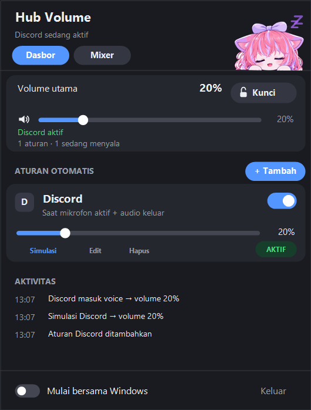

# Hub Volume

A small Windows mixer that can **lock** the volume of output devices, microphones, and individual apps. If something changes a locked level — media keys, the Windows mixer, another app, headset software — Hub Volume puts it straight back.

<p align="center">
  
</p>

Windows 10/11 · native C++ · single executable · no installer required

## Features

- **Automatic volume rules.** When a chosen app joins a call, its volume drops to the level you set, then goes back on its own. One rule per app, with ready-made presets for Discord, Zoom, Teams, Google Meet, Skype, Slack, Webex, Telegram, and WhatsApp Desktop.
- **Per-target locks** for playback devices, microphones, and application sessions. The lock button captures the current level and mute state.
- **Event-driven**, not polling. Locks use Core Audio callbacks, so an idle process costs 0% CPU.
- **Survives sessions and devices coming and going.** App locks are keyed by executable name; device locks by endpoint ID, so they reapply when Discord restarts or a headset is reconnected.
- **Works with every active endpoint**, not just the default device.
- **Tray first.** The mixer window is created when opened and destroyed when closed, along with its GDI+ session.
- **Optional autostart** per user, without administrator rights or a scheduled task.
- **DPI aware** with light and dark themes that follow Windows.
- **One binary.** Static CRT, no .NET, no WebView2, no Qt.

## Install

Download from [Releases](https://github.com/thewoldaa/hub-volume/releases):

| File | Description |
| --- | --- |
| `HubVolume-Setup-1.1.0.exe` | Per-user installer. No admin prompt. |
| `HubVolume-1.1.0-portable.zip` | Extract anywhere and run `HubVolume.exe`. |

The binaries are not code-signed, so Windows SmartScreen may show a warning on first run. The source is in this repository and the build is reproducible with the steps below.

## Usage

1. Start `HubVolume.exe`. A speaker icon appears near the clock.
2. Click the icon to open the mixer.
3. Set a level, then press **Kunci** on that row. The lock icon turns amber and the value is protected.
4. Press **Terkunci** to release it. **Buka kunci semua** is available from the tray menu.

### Automatic rules

1. Open the **Dasbor** tab and press **+ Tambah**.
2. Pick an app from the running list, a preset, or a `.exe` by hand.
3. Choose how far the volume should drop and which volume it controls (master or the app itself).
4. Pick a restore delay, then **Simpan**. Use **Simulasi** on the card to test it without waiting for a real call.

Rules fire when the app opens the microphone or plays audio, whichever you enable. If several rules match at once, the lowest target wins. A lock on the same target follows the rule and comes back to its original position afterwards, and changes you make by hand while a rule is active are kept.

The bottom bar has **Mulai bersama Windows** (start with Windows) and **Keluar** (quit). Locks only work while Hub Volume is running; quitting with active locks shows a confirmation.

Settings, rules, and the lock list are stored in `%LOCALAPPDATA%\HubVolume\config.json`. App presets live in `presets.json` next to it and can be edited by hand.

## Build

Requirements:

- Windows 10/11
- Visual Studio 2022 with the Desktop C++ workload (or MinGW-w64)
- CMake 3.20+
- NSIS 3.x (only for the installer)

```powershell
# Portable exe + zip, and the installer if makensis is available
.\scripts\build.ps1

# Portable only
.\scripts\build.ps1 -SkipInstaller
```

Output lands in `release/`. A manual CMake build works too:

```powershell
cmake -S . -B dist/build -G "Visual Studio 17 2022" -A x64
cmake --build dist/build --config Release
```

## How it works

Each endpoint gets an `IAudioEndpointVolume` callback, and each app session an `IAudioSessionEvents` callback. Callbacks never touch audio APIs or application state; they post a message with a numeric target ID to the main window. The main thread reads the actual value, compares it with the locked value, and writes the correction with a private event GUID so its own changes do not bounce back.

Rules reuse the same signals: a background pass maps running processes to their audio sessions and to capture sessions, and only runs while at least one rule is enabled. A matching rule saves the current level, applies the target, and starts a restore timer; the saved baseline is what comes back, not a fixed number.

Corrections for the same target are rate-limited to roughly 80 per second. Targets that are not locked are only read while the mixer window is open. A lock is a plain record in `config.json`, written atomically through a temporary file; slider drags are debounced so the disk is not hit for every pixel.

## Limitations

- Not a service: locks stop when the process exits.
- Per-user only. Installing for all users is not supported.
- Volume is controlled through WASAPI; apps that bypass it (exclusive mode, some DAWs) are outside its reach.
- On Windows 10, window corners are square because rounded corners are a Windows 11 DWM feature.

## Sponsor

Hub Volume is free and GPL-3.0. If it saves your ears, you can support development on [Patreon](https://www.patreon.com/c/Craftkal).

## License

[GPL-3.0](LICENSE). Mascot artwork by CraftKal.
